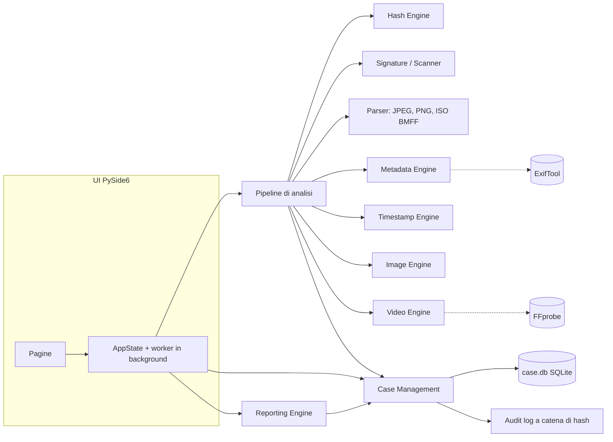

# Forensic Vision Pro — Architettura

## Principi

1. **Preservazione delle evidenze.** L'originale viene solo letto (`open(..., "rb")`), una volta, durante l'acquisizione. Tutte le analisi lavorano su una copia di lavoro resa di sola lettura, con hash verificati prima e dopo ogni analisi.
2. **Trasparenza dei risultati.** Ogni risultato (`Finding`) dichiara livello (evidenza certa, anomalia tecnica, indicatore sospetto, risultato probabilistico, non determinabile, informativo), metodo, evidenza, posizione nel file, confidenza e limiti. Non esiste un punteggio di autenticità.
3. **Riproducibilità.** Ogni analisi registra versione dell'applicazione e degli strumenti esterni, moduli eseguiti, parametri e hash.
4. **Isolamento dai file malevoli.** Parser con limiti espliciti (numero di nodi, profondità, dimensione), strumenti esterni senza shell e con timeout, limite di pixel contro le decompression bomb, nessuna esecuzione di contenuti incorporati.
5. **Moduli indipendenti.** Ogni engine è una funzione pura su un percorso di file che restituisce dati e `Finding`; l'interfaccia non contiene logica forense.

## Componenti



| Livello | Package | Responsabilità |
|---|---|---|
| Core | `fvp.core` | modello `Finding` e stato per categoria, audit log, configurazione, strumenti esterni, cancellazione, pipeline |
| Engine | `fvp.engines` | hashing, firme, metadati, analisi temporale, immagine, video |
| Parser | `fvp.parsers` | struttura binaria dei formati; registro estendibile (`registry.register`) |
| Casi | `fvp.cases` | casi, reperti, acquisizione, analisi salvate, note dell'operatore, custodia |
| Report | `fvp.reporting` | HTML autocontenuto, JSON completo, CSV dei risultati |
| UI | `fvp.ui` | finestra, pagine, widget (Hex Viewer, viste sincronizzate, risultati) |

## Fondamenti scientifici dei moduli d'immagine

| Modulo | Riferimento |
|---|---|
| JPEG ghost | H. Farid, *Exposing digital forgeries from JPEG ghosts*, IEEE TIFS 2009 |
| Doppia quantizzazione | A. Popescu, H. Farid, *Statistical tools for digital forensics*, IH 2004; Z. Lin et al., *Fast, automatic and fine-grained tampered JPEG image detection via DCT coefficient analysis*, Pattern Recognition 2009 |
| Copy-move | I. Amerini et al., *A SIFT-based forensic method for copy-move attack detection*, IEEE TIFS 2011 |
| Steganalisi RS | J. Fridrich, M. Goljan, R. Du, *Reliable detection of LSB steganography in color and grayscale images*, ACM MM&Sec 2001 |
| Chi-quadro | A. Westfeld, A. Pfitzmann, *Attacks on steganographic systems*, IH 1999 |
| PRNU | J. Lukáš, J. Fridrich, M. Goljan, *Digital camera identification from sensor pattern noise*, IEEE TIFS 2006; M. Goljan, J. Fridrich, T. Filler, *Large scale test of sensor fingerprint camera identification*, SPIE 2009 |
| SSIM | Z. Wang et al., *Image quality assessment: from error visibility to structural similarity*, IEEE TIP 2004 |
| Rumore | J. Immerkær, *Fast noise variance estimation*, CVIU 1996 |

Il modulo StegoIntelligence implementa le tecniche elencate dal progetto StegoIntelligence di CScorza, che è un catalogo di tecniche e strumenti senza codice. Nessuno strumento esterno di steganografia viene eseguito sui reperti.

L'elenco delle funzioni della milestone 2 prende spunto da PixIntelligence (licenza CC BY-NC-SA 4.0): nessuna parte del suo codice è stata copiata, così il progetto non eredita il vincolo di uso non commerciale.

## Flusso di un'analisi

1. `Case.acquire`: stat dell'originale (prima della lettura, che può aggiornare l'atime) → copia in un solo passaggio con hash multipli → seconda lettura della copia e confronto → `chmod` sola lettura → voce di custodia.
2. `analyze_exhibit`: hash iniziale e confronto con l'acquisizione (se diverso l'analisi si ferma) → firma → struttura → metadati → tempi → immagine o video → scansione delle firme → hash finale.
3. Un errore in un modulo produce un `Finding` "non determinabile" con il motivo e non interrompe gli altri.
4. Risultati, hash e versioni degli strumenti sono salvati nella tabella `analyses`; l'evento è nel registro.

## Registro delle operazioni

Tabella `audit_log`: ogni voce contiene `prev_hash` e `entry_hash = SHA-256(seq, ts, attore, azione, tipo, dettagli, prev_hash)`. I trigger SQLite bloccano UPDATE e DELETE dall'applicazione; chi rimuovesse i trigger con accesso diretto al file renderebbe la modifica rilevabile da `verify()`. L'hash di testa è riportato nel report come ancora esterna: conservarlo fuori dal caso (es. nel verbale) rende rilevabile anche la sostituzione dell'intero registro.

## Controllo del sistema e build

`core/selfcheck.py` verifica pacchetti Python, SIFT, classificatori Haar, ExifTool (lettura reale di un JPEG generato), FFprobe (lettura reale di un WAV generato), integrità dei binari inclusi rispetto a `bin/tools.lock.json` e scrivibilità delle cartelle di lavoro. Viene eseguito all'avvio dell'interfaccia, da Settings e dalla build, prima sui sorgenti e poi sull'eseguibile finito con `ForensicVisionPro.exe --selfcheck report.json`. La build si interrompe se un componente essenziale non funziona.

## Struttura delle cartelle

```
ForensicVisionPro/
├── src/fvp/
│   ├── core/        findings.py, audit.py, pipeline.py, config.py, tools.py, tasks.py, selfcheck.py
│   ├── engines/     hashing.py, signature.py, metadata.py, timestamps.py, image.py, video.py,
│   │                jpeg_forensics.py, image_extra.py, stego.py, stegointel.py, prnu.py, compare.py
│   ├── parsers/     base.py, jpeg.py, png.py, isobmff.py, registry.py
│   ├── cases/       store.py
│   ├── reporting/   report.py
│   (plugins/ previsto nella milestone 5)
│   └── ui/          app.py, main_window.py, state.py, theme.py, pages/, widgets/
├── tests/           unità, integrazione su dataset a verità nota, UI offscreen
├── tools/           make_testdata.py (dataset sintetico con MANIFEST.json)
├── packaging/       fvp.spec, installer.iss, build_windows.ps1
├── bin/             ExifTool e FFmpeg da includere nella build
└── docs/
```

Ogni caso su disco: `case.db`, `evidence/EXH-NNNN/` (copie di lavoro), `artifacts/EXH-NNNN/` (mappe ELA e rumore), `reports/`.

## Dipendenze

| Componente | Uso | Note |
|---|---|---|
| Python ≥ 3.10 | runtime | testato con 3.12 |
| PySide6 | interfaccia | LGPL |
| Pillow, NumPy, OpenCV (headless) | decodifica e analisi raster | |
| ExifTool ≥ 12.70 | metadati | esterno; fallback limitato su Pillow |
| FFmpeg / FFprobe ≥ 6 | video | esterno |
| pytest, PyInstaller, Inno Setup | test e packaging | solo sviluppo |

Dipendenze previste nelle milestone successive: PyAV (frame), ONNX Runtime (modelli AI e deepfake), ReportLab (PDF), `c2pa-python` (validazione C2PA).

## Strategia di test

- **Unità:** hash confrontati con `hashlib`; manomissione e cancellazione nel registro; acquisizione che non altera originale né mtime; regole di stato per categoria; parsing date e fusi orari.
- **Integrazione:** `tools/make_testdata.py` genera file con una verità nota (modifica localizzata, date future, GPS incoerente, dati accodati, troncamenti, CRC errato, parametri AI, tracce video con date diverse) descritta in `MANIFEST.json`; i test verificano che ogni risultato atteso venga rilevato e che i file puliti non producano risultati significativi.
- **UI:** costruzione di tutte le pagine in modalità offscreen, ricerca nell'Hex Viewer.
- I test che richiedono ExifTool o FFmpeg vengono saltati, con motivazione, se lo strumento manca.
